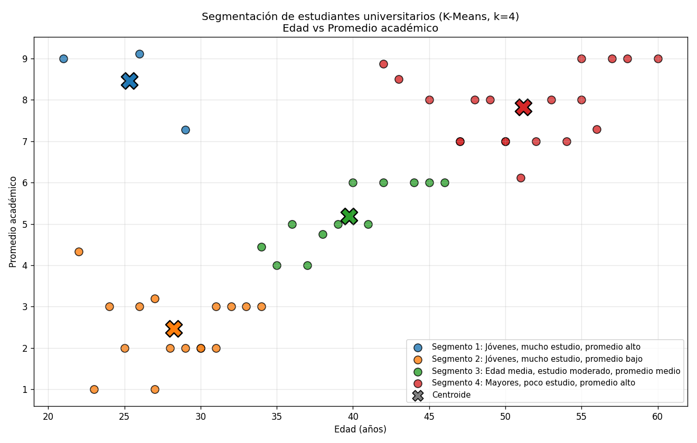

# TP 9 — K-Means, Punto B: Estudiantes Universitarios

### Materia: Procesamiento de Aprendizaje Automático

---

## Descripción

Este trabajo práctico aplica el algoritmo de clustering **K-Means** para agrupar a **50 estudiantes universitarios** en **4 segmentos** según tres variables:

- **Edad** (años)
- **Horas de estudio semanales**
- **Promedio académico**

El objetivo es descubrir perfiles de estudiantes con características similares, sin indicarle al algoritmo de antemano cuáles son esos perfiles (aprendizaje no supervisado).

---

## Estructura del proyecto

```
.
├── kmeans_estudiantes.py    # Script principal
├── grafico_estudiantes.png  # Gráfico generado al ejecutar el script
└── README.md
```

---

## Requisitos e instalación

- Python 3.8 o superior
- Librerías: `pandas`, `scikit-learn`, `matplotlib`

```bash
pip install pandas scikit-learn matplotlib
```

## Ejecución

```bash
python kmeans_estudiantes.py
```

El script imprime el informe de resultados en la consola, guarda el gráfico como `grafico_estudiantes.png` y además lo abre en una ventana.

---

## Explicación del código

### Carga de los datos

```python
estudiantes = [
    {'edad': 42, 'horas_estudio': 2, 'promedio_academico': 8.87},
    ...
]
df = pd.DataFrame(estudiantes)
variables = ['edad', 'horas_estudio', 'promedio_academico']
```

Los 50 estudiantes de la consigna están en una lista de diccionarios, donde cada diccionario es un estudiante. Esa lista se convierte en un **DataFrame de pandas**: una tabla con una fila por estudiante y una columna por variable. La lista `variables` guarda los nombres de las tres columnas que se usan para agrupar.

Antes de procesar, el script imprime estadísticas descriptivas con `describe()` (media, desvío, mínimo, máximo y cuartiles) para conocer los datos.

### 1. Estandarización de los datos

```python
scaler = StandardScaler()
X_std = scaler.fit_transform(df[variables])
```

**Por qué es necesario:** K-Means agrupa usando la **distancia euclídea** entre puntos. Las tres variables tienen escalas muy distintas:

| Variable | Rango aproximado |
|---|---|
| Edad | 21 a 60 |
| Horas de estudio | 2 a 15 |
| Promedio académico | 1 a 9,11 |

Sin estandarizar, una diferencia de 10 años de edad pesaría mucho más que una diferencia de 5 puntos de promedio, aunque esta última sea mucho más significativa. La edad dominaría el agrupamiento.

**Qué hace `StandardScaler`:** transforma cada variable para que tenga **media 0 y desvío estándar 1**, con la fórmula:

$$z = \frac{x - \text{media}}{\text{desvío estándar}}$$

Así las tres variables quedan en la misma escala y aportan lo mismo al cálculo de distancias. Un valor de `z = 1` significa "un desvío por encima de la media", sin importar si se trata de años, horas o notas.

- `fit` calcula la media y el desvío de cada columna.
- `transform` aplica la fórmula.
- `fit_transform` hace las dos cosas en un solo paso.

El script imprime las primeras filas estandarizadas para mostrar el resultado de la transformación.

### 2. Agrupamiento en 4 segmentos

```python
kmeans = KMeans(n_clusters=4, random_state=42, n_init=10)
df['cluster'] = kmeans.fit_predict(X_std)
```

- **`n_clusters=4`**: se piden 4 segmentos, como indica la consigna.
- **`random_state=42`**: fija la semilla aleatoria. Como K-Means elige los centroides iniciales al azar, esto garantiza que el resultado sea siempre el mismo.
- **`n_init=10`**: ejecuta el algoritmo 10 veces con distintos puntos de partida y se queda con la mejor solución (la de menor inercia).
- **`fit_predict(X_std)`**: entrena el modelo sobre los **datos estandarizados** y devuelve el cluster asignado a cada estudiante.

#### Volver los centroides a la escala original

```python
centroides = pd.DataFrame(
    scaler.inverse_transform(kmeans.cluster_centers_), columns=variables
)
```

Los centroides que calcula K-Means están en escala estandarizada (valores como `-1.2` o `0.8`), que no se pueden interpretar directamente. Con **`inverse_transform`** se deshace la estandarización y se obtienen en las unidades reales: años, horas y nota.

#### Numeración estable de los segmentos

```python
orden = centroides['edad'].sort_values().index
renumerar = {viejo: nuevo + 1 for nuevo, viejo in enumerate(orden)}
df['segmento'] = df['cluster'].map(renumerar)
```

K-Means numera los clusters de forma arbitraria (0, 1, 2, 3). Para que la salida sea más ordenada, los clusters se renumeran del **1 al 4 según la edad promedio** de cada uno: el segmento 1 es el más joven y el 4 el de mayor edad.

### 3. Etiquetas descriptivas automáticas

```python
def nivel(z, bajo, medio, alto):
    if z < -0.5:
        return bajo
    if z > 0.5:
        return alto
    return medio

def describir(c):
    z = scaler.transform(pd.DataFrame([c], columns=variables))[0]
    edad  = nivel(z[0], "jóvenes", "edad media", "mayores")
    horas = nivel(z[1], "poco estudio", "estudio moderado", "mucho estudio")
    prom  = nivel(z[2], "promedio bajo", "promedio medio", "promedio alto")
    return f"{edad.capitalize()}, {horas}, {prom}"
```

En lugar de escribir los nombres de los segmentos a mano, el programa los genera a partir de cada centroide:

1. Se toma el centroide en escala estandarizada (z-score).
2. Para cada variable se decide un nivel:
   - **menos de −0,5 desvíos** respecto de la media → nivel **bajo**
   - **más de +0,5 desvíos** → nivel **alto**
   - **entre −0,5 y +0,5** → nivel **medio**
3. Se arma la etiqueta combinando los tres niveles, por ejemplo: *"Jóvenes, mucho estudio, promedio bajo"*.

Tener un nivel "medio" evita que un grupo cercano al promedio general quede mal etiquetado como alto o bajo.

### 4. Informe de resultados

El script imprime en consola:

- **Centroides** de cada segmento en escala original.
- **Cantidad de estudiantes** por segmento.
- Para cada segmento: su etiqueta y los **rangos (mínimo–máximo) y medias** de edad, horas y promedio.
- La **matriz de correlación** entre las tres variables, que ayuda a entender qué relaciones hay en los datos.

### 5. Visualización 2D: Edad vs Promedio

```python
plt.scatter(grupo['edad'], grupo['promedio_academico'], color=colores[s], ...)
plt.scatter(centroides.loc[s, 'edad'], centroides.loc[s, 'promedio_academico'],
            marker='X', s=350, ...)
```

- Se dibuja un gráfico de dispersión con la **edad en el eje X** y el **promedio académico en el eje Y**, en sus valores originales, para que se lean fácilmente.
- Cada segmento tiene su propio color.
- Los **centroides** se marcan con una **X grande** del color de su segmento.
- El gráfico se guarda como `grafico_estudiantes.png` y se muestra en pantalla.

> **Aclaración:** el agrupamiento se hace con las **tres** variables, pero el gráfico muestra solo dos (edad y promedio), como pide la consigna. La variable horas de estudio también influye en los grupos aunque no se vea en el gráfico.

---

## Resultados

### Segmentos obtenidos

| Segmento | Estudiantes | Edad media | Horas de estudio (media) | Promedio (media) |
|---|---|---|---|---|
| **1. Jóvenes, mucho estudio, promedio alto** | 3 | 25,3 | 12,3 | 8,46 |
| **2. Jóvenes, mucho estudio, promedio bajo** | 16 | 28,3 | 11,9 | 2,47 |
| **3. Edad media, estudio moderado, promedio medio** | 12 | 39,8 | 7,3 | 5,18 |
| **4. Mayores, poco estudio, promedio alto** | 19 | 51,2 | 4,1 | 7,83 |

**Rangos de cada segmento:**

| Segmento | Edad | Horas | Promedio |
|---|---|---|---|
| 1 | 21–29 | 8–15 | 7,27–9,11 |
| 2 | 22–34 | 9–15 | 1,0–4,33 |
| 3 | 34–46 | 6–10 | 4,0–6,0 |
| 4 | 42–60 | 2–8 | 6,12–9,0 |

### Correlaciones entre variables

|  | Edad | Horas de estudio | Promedio |
|---|---|---|---|
| **Edad** | 1,00 | −0,92 | 0,71 |
| **Horas de estudio** | −0,92 | 1,00 | −0,73 |
| **Promedio** | 0,71 | −0,73 | 1,00 |

### Gráfico



**Cómo se lee el gráfico:**

- **Eje X:** edad del estudiante, en años.
- **Eje Y:** promedio académico.
- **Cada punto** es un estudiante, coloreado según su segmento:
  - 🔵 **Azul — Segmento 1:** Jóvenes, mucho estudio, promedio alto
  - 🟠 **Naranja — Segmento 2:** Jóvenes, mucho estudio, promedio bajo
  - 🟢 **Verde — Segmento 3:** Edad media, estudio moderado, promedio medio
  - 🔴 **Rojo — Segmento 4:** Mayores, poco estudio, promedio alto
- **Las X grandes** son los centroides: el "estudiante promedio" de cada segmento.

**Qué muestra:**

- Los puntos forman una especie de **diagonal ascendente**: a mayor edad, mayor promedio.
- **Abajo a la izquierda** (naranja) está el grupo más numeroso de jóvenes, entre 22 y 34 años, con promedios bajos (de 1 a 4,3).
- **En el centro** (verde) está el grupo intermedio, de 34 a 46 años, con promedios entre 4 y 6.
- **Arriba a la derecha** (rojo) se concentran los estudiantes mayores, de 42 a 60 años, con promedios altos (de 6 a 9).
- **Arriba a la izquierda** (azul) aparecen solo 3 estudiantes jóvenes con promedio alto. Rompen el patrón general y K-Means los separa en su propio segmento.
- Hay una zona de **superposición entre los 42 y 46 años**, donde conviven puntos verdes y rojos. Ahí el factor que los separa es el promedio y las horas de estudio, no la edad.

---

## Análisis de los resultados

1. **La estandarización fue clave.** Sin ella, el agrupamiento habría dependido casi solo de la edad, por ser la variable de mayor rango numérico.

2. **Relación fuerte entre las variables.** La edad y las horas de estudio tienen una correlación de −0,92: los estudiantes mayores estudian muchas menos horas. A su vez, la edad se asocia positivamente con el promedio (+0,71).

3. **Resultado contraintuitivo.** En este dataset, **estudiar más horas se asocia con un promedio más bajo** (correlación −0,73). El segmento 2 es el ejemplo más claro: estudian cerca de 12 horas semanales y tienen el promedio más bajo (2,47). El segmento 4 estudia solo unas 4 horas y tiene un promedio de 7,83.
   Algunas hipótesis posibles son que los estudiantes mayores tienen más experiencia o métodos de estudio más eficientes, o que quienes tienen dificultades dedican más horas para compensar. Sin embargo, al tratarse de **datos de ejemplo**, esta relación es más una característica del dataset que una conclusión sobre estudiantes reales.

4. **El segmento 1 es un grupo de excepción.** Son 3 jóvenes que estudian mucho y tienen buen promedio. Es el único grupo donde estudiar más se asocia con mejores notas. Que K-Means le dedique un cluster muestra que el algoritmo detecta perfiles minoritarios cuando son claramente distintos del resto.

5. **Segmentos desbalanceados.** Los grupos tienen tamaños muy distintos (3, 16, 12 y 19). K-Means no busca grupos del mismo tamaño, sino grupos compactos alrededor de su centroide.

6. **Limitaciones.** K-Means requiere fijar la cantidad de clusters de antemano. Para justificar la elección de k se podría usar el **método del codo** (inercia según k) o el **coeficiente de silueta**.